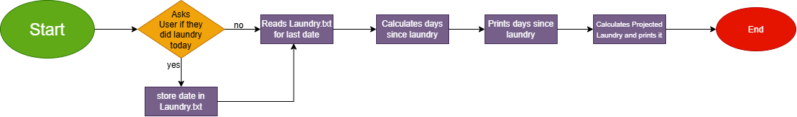

# Laundry Tracker

Tracks when to do laundry next and how long it has been since you have done laundry. 

## The Problem

I keep forgetting when the last time I did laundry was, so I want to build a program to help me keep track of how many days it has been and when I should do it again. 
This will help me do laundry regularly and also not too often.

## How It Works

A java program that keeps track of how many days it has been since I did 
laundry gathering information and printing information using the terminal. It will ask the user if they have done laundry, 
and if they have it will store the date as the last date laundry was done. Then it will calculate how many days since laundry was done and them predict the date 
of when you should do laundry.



## Tech Stack

- **Language:** Java
- **Libraries:**: This project imports:
                    javax.swing in order to set up a nice looking GUI for the user to interact with,
                    java.time to assist with analyzing the current day and when the user needs to do laundry next,
                    java.time.temporal.ChronoUnit in order to easily compare dates and get how many days are in between them,
                    java.awt.Color is used to color the answers blue,
                    java.io is used to read and write to the laundry file so that this program can still keep track of the data even when the user closes the app.
## Setup

Step-by-step: how does someone who just cloned your repo get it
running?

```bash
git clone https://github.com/hopeshunta/CS_Tools_Final_Project.git
cd CS_Tools_Final_Project
#Compile the tracker
javac LaundryTracker.java
#Run the tracker
java LaundryTracker
```

## Usage
Once you have run the program decide whether you have done laundry today or not. 
Based on your response the screen will change and display the last day you did laundry, 
how many days it has been since then, and the predicted day you should do laundry next.

```
